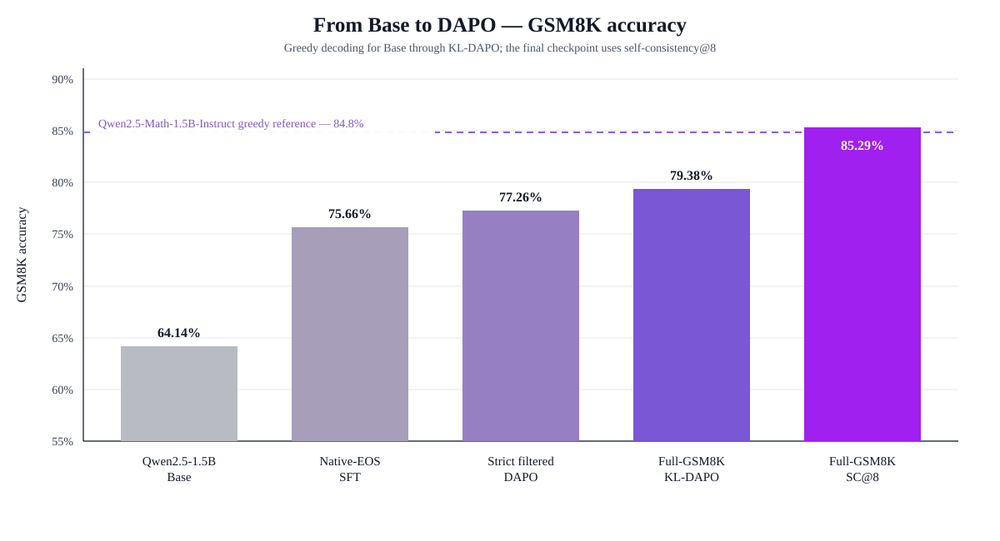
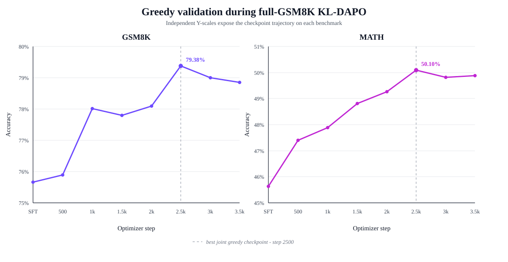

# Math Post-Training on Qwen2.5-1.5B Base

[](https://github.com/NotHotTryHard/math-post-training/pkgs/container/math-post-training)
[](LICENSE)

**A reproducible Base → SFT → DAPO post-training pipeline, with GSM8K as the primary target
and MATH as the harder generalization benchmark.**

Starting from **[`Qwen/Qwen2.5-1.5B`](https://huggingface.co/Qwen/Qwen2.5-1.5B) Base**, the pipeline
reaches **79.38% GSM8K / 50.10% MATH with greedy decoding** and
**85.29% GSM8K / 57.78% MATH with self-consistency@8** on one A100 80 GB.
The experiments cover SFT on OpenMathInstruct-2, prompt and EOS format, RL data filtering,
reward design, and KL regularization.

The math-specialized **Qwen2.5-Math-1.5B-Instruct** serves as a stronger-model reference:
its reported greedy scores are **84.80% GSM8K / 75.81% MATH**
([technical report](https://arxiv.org/abs/2409.12122)).

[Results](#results) · [Recipe](#recipe) · [Reproduce](#reproduce) · [Experiment notes](#experiment-notes)

## Results



All project results below were measured locally with the repository evaluator. Greedy runs use `max_new_tokens=2048`. SC@8 uses 8 samples at `temperature=0.8`, `top_p=0.95`, then selects the most frequent normalized final answer.

| Model / checkpoint | Decoding | GSM8K | GSM1K | MATH | MMLU-STEM |
| --- | --- | ---: | ---: | ---: | ---: |
| Qwen2.5-1.5B Base, local baseline | greedy | 64.14 | 58.17 | 32.08 | 42.31 |
| ChatML SFT, 98K | greedy | 69.60 | 64.23 | 33.74 | **52.17** |
| Native-EOS SFT, 296K | greedy | 75.66 | 69.88 | 45.64 | 41.93 |
| Strict filtered-GSM8K DAPO | greedy | 77.26 | 72.20 | 49.84 | **44.59** |
| Full-GSM8K KL-DAPO, step 2500 | greedy | **79.38** | 71.70 | **50.10** | 43.42 |
| Strict filtered-GSM8K DAPO | SC@8 | 83.02 | **79.50** | **58.40** | 49.35 |
| Full-GSM8K KL-DAPO, step 3000 | SC@8 | **85.29** | 78.34 | 57.78 | **49.38** |

In the earlier permissive-reward runs, GSM8K changed little while MATH improved. I kept both
benchmarks in the checkpoint sweep to track that difference.

### Full-GSM8K KL-DAPO checkpoint sweep



GSM8K fluctuates after step 1000; MATH improves more steadily until step 2500.
The [full checkpoint report](docs/full-gsm8k-kl-dapo-2026-08-29.md) includes all four benchmarks
and the comparison between greedy and SC@8.

> [!NOTE]
> These sweeps informed checkpoint selection on the test benchmarks. The selected scores are
> therefore exploratory results, not an independent held-out estimate. Future model selection
> needs a separate validation set.

## Recipe

| Stage | Setup |
| --- | --- |
| Base model | `Qwen/Qwen2.5-1.5B` |
| SFT | 296K OpenMathInstruct-2 examples, one epoch; plain prompts and native `<\|endoftext\|>` EOS |
| LoRA | Rank 32, alpha 64; SFT dropout 0.05, all linear layers |
| RL data and reward | Full GSM8K train; correct box `+1`, wrong box `0`, missing/incomplete box `-0.5` |
| RL objective | DAPO token-level loss, clipping `0.2/0.28`, group-scaled reward, KL `beta=1e-3` |
| Rollouts and updates | 16 answers per prompt; 64 completions/update, microbatch 8 × accumulation 8 |
| RL schedule | LR `1e-5`, cosine decay, 400 warmup steps; greedy evaluation every 500 steps |
| Hardware and stack | One A100 80 GB; TRL + PEFT, colocated vLLM with sleep disabled |

Use **checkpoint 2500 for greedy decoding**, or **3000 for SC@8**. The
[RL config](configs/grpo/qwen2_5_1_5b_openmath_gsm8k_full_dapo_strict_kl1e3_long.yaml)
contains the full training settings; [training notes](docs/training-notes.md) explain how I arrived
at them.

## Reproduce

The [GHCR image](https://github.com/NotHotTryHard/math-post-training/pkgs/container/math-post-training)
contains the training and evaluation environment. Copy `.env.example` to `.env` and configure
access as described in the [setup guide](docs/reproducibility.md#environment).

For example, to evaluate the native-EOS SFT checkpoint:

```bash
docker run --rm --gpus all --ipc=host --env-file .env \
  -v "$PWD/outputs:/workspace/outputs" \
  ghcr.io/nothottryhard/math-post-training:dev \
  model-eval \
    --config configs/eval/qwen2_5_1_5b_openmath_native_eos_greedy.yaml \
    --output-dir /workspace/outputs/eval
```

`dev` follows the latest build. Use an immutable `sha-<commit>` image tag to pin the environment.

| Checkpoint | Link |
| --- | --- |
| Native-EOS SFT | [Hugging Face](https://huggingface.co/NotHotTryHard/qwen2.5-1.5b-base-openmath-296k-1epoch-lora-cosine-native-eos-merged) |
| KL-DAPO 2500 — greedy | [Hugging Face](https://huggingface.co/NotHotTryHard/qwen2.5-1.5b-openmath-native-eos-gsm8k-full-dapo-strict-kl1e3-long/tree/main/checkpoint-2500) |
| KL-DAPO 3000 — SC@8 | [Hugging Face](https://huggingface.co/NotHotTryHard/qwen2.5-1.5b-openmath-native-eos-gsm8k-full-dapo-strict-kl1e3-long/tree/main/checkpoint-3000) |

The checkpoints require Hugging Face account access. The RL links contain LoRA checkpoints;
see the [reproduction guide](docs/reproducibility.md) for checkpoint evaluation, training, resume,
and SC@8 commands.

## Experiment notes

A few observations shaped the final setup:

- Plain prompts and the Base model's native EOS resolved the stopping problems I saw with ChatML.
  Data volume changed too, so the score difference is not a format-only ablation.
- The KL run gave the best joint greedy GSM8K/MATH score. Its gain over the best full-data
  beta-zero checkpoint was small, and it did not win on every benchmark.
- Mixing in DeepMath did not improve on GSM8K-only training in the tested setup.

The [training notes](docs/training-notes.md) collect the comparisons and explain the decisions.
The original reports contain the detailed measurements:

| Experiment | Report |
| --- | --- |
| SFT LoRA scaling and batch size | [SFT ablations](docs/sft-ablation-2026-08-21.md) |
| Native-EOS SFT trajectory | [Checkpoint sweep](docs/sft-native-eos-checkpoint-sweep-2026-08-23.md) |
| RL batch size and throughput | [DAPO ablations](docs/dapo-gsm8k-batch-ablation-2026-08-24.md) |
| Strict reward and data filtering | [Strict DAPO experiments](docs/strict-dapo-deepmath-pilot-2026-08-24.md) |
| DeepMath selection | [Difficulty audit](docs/deepmath-level-audit-2026-08-28.md) |
| KL and inference scaling | [Final KL-DAPO report](docs/full-gsm8k-kl-dapo-2026-08-29.md) |
| GPU scheduling | [Runtime notes](docs/grpo-runtime-and-update-notes.md) |

These are single-seed experiments at one model size. SC@8 uses eight generations per problem;
its scores have a different inference budget from greedy decoding. Comparisons to published
Qwen-Math results also depend on prompt, decoding, and verifier differences.

## Compute budget

| | Clean final pipeline (active) | Full study + ablations (billed) |
| --- | ---: | ---: |
| Evaluation | ~30 min | ~16.0 h |
| SFT training | ~7.5 h | ~45.0 h |
| Data filtering and dataset audits | — | ~11.0 h |
| RL training | ~6.9 h | ~52.4 h |
| **Total GPU time** | **~14.9 h** | **~124.4 h** |

## Research and tooling

The project author set the research direction, designed the experiments and ablations, selected
the models, interpreted the results, and handled RunPod orchestration and part of the diagnostics.
[codex-cli](https://github.com/openai/codex) supported implementation, test writing, and
documentation. It accelerated the engineering loop without making the research decisions or
drawing the conclusions.

## References and related work

- [Qwen2.5-Math Technical Report](https://arxiv.org/abs/2409.12122) — Qwen's SFT, reward-model,
  GRPO, and inference-scaling pipeline.
- [DeepSeekMath](https://arxiv.org/abs/2402.03300) — introduces GRPO for mathematical reasoning.
- [DAPO](https://arxiv.org/abs/2503.14476) — decoupled clipping, dynamic sampling, token-level loss,
  and overlong-reward shaping at scale.
- [OpenMathInstruct-2](https://huggingface.co/datasets/nvidia/OpenMathInstruct-2) — the SFT source.
- [DeepMath-103K](https://huggingface.co/datasets/zwhe99/DeepMath-103K) — the broader mathematics
  dataset evaluated in the mixed RL experiment.
- [Hugging Face TRL SFTTrainer](https://huggingface.co/docs/trl/sft_trainer) — the supervised
  fine-tuning interface and dataset-format reference.
- [TRL GRPOTrainer](https://huggingface.co/docs/trl/index) and [vLLM](https://vllm.ai/) — the training
  and generation stack used here.
- [DrEternity/gsm8k-post-training](https://github.com/DrEternity/gsm8k-post-training) — an adjacent
  open GSM8K SFT/GRPO project and a useful point of comparison for experiment structure.
- [codex-cli](https://github.com/openai/codex) — the terminal engineering assistant used
  during development.
